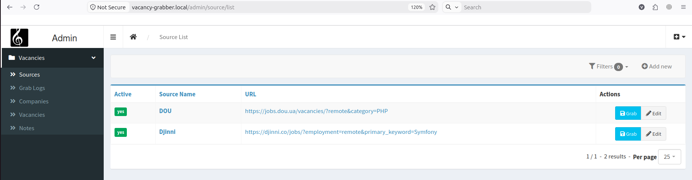

# Vacancy grabber
Grab vacancies by source URL

## Requirements:
- php 8.4
- mysql 8

## Installation:

### Add a host 
edit /etc/hosts  
add a new host: vacancy-grabber.local

### Compile all docker images

#### Build docker images
```bash
make docker-build
```

#### Run docker images
```bash
make docker-up
```

#### Run docker logs
```bash
make docker-logs
```

#### Connect to php-fpm console
```bash
make php-console
```

#### Connect to mysql console
```bash
make mysql-console
```

[//]: # (#### Connect to nodejs console)
[//]: # (```bash)
[//]: # (make nodejs-console)
[//]: # (```)

#### Install vendor packages
```bash
make composer-install
```

#### Run Migrations
- `make migrate`

## Code Style:
> **_NOTE:_** All commands must be executed inside docker image
### PHP
#### Check
- `$ composer run lint`
#### Fix
- `$ composer run lint:fix`

## Start using:
### Sources
- Open [Vacancies ⇒ Sources](https://vacancy-grabber.local/admin/source/list) left menu 
- Update URL for the required sources 
- Click on the "Grab" action button for the chosen sources
  
