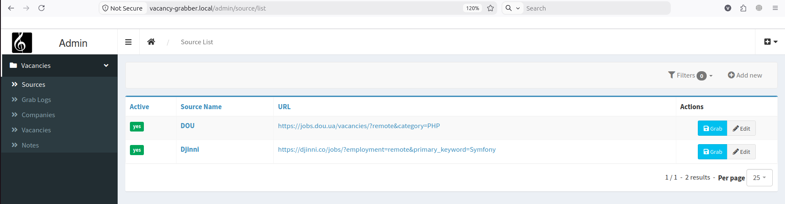

# Vacancy grabber
Grab vacancies by source URL

## Requirements:
- php 8.4
- mysql 8

## Installation:

### Add a host 
edit /etc/hosts  
add a new host: vacancy-grabber.local

### Compile all docker images

#### Build docker images
```bash
make docker-build
```

#### Run docker images
```bash
make docker-up
```

#### Run docker logs
```bash
make docker-logs
```

#### Connect to php-fpm console
```bash
make php-console
```

#### Connect to mysql console
```bash
make mysql-console
```

[//]: # (#### Connect to nodejs console)
[//]: # (```bash)
[//]: # (make nodejs-console)
[//]: # (```)

#### Install vendor packages
```bash
make composer-install
```

#### Run Migrations
```bash
make migrate
```

## Code Style:

### PHP
> **_NOTE:_** All commands must be executed inside docker image

#### Check
```bash
composer run lint
```
#### Fix
```bash
composer run lint:fix
```

## Start using:
### Sources
- Open [Vacancies ⇒ Sources](https://vacancy-grabber.local/admin/source/list) left menu 
- Update URL for the required sources 
- Click on the "Grab" action button for the chosen sources
  

## Deploy to live (VPS)

The production image is built from the root `Dockerfile` (targets `app` and `nginx`). The stack lives in `docker-compose.prod.yaml`: php-fpm, the messenger worker, nginx and mysql.

### One-time server setup
1. Install Docker and the compose plugin.
2. Point the domain's DNS A record at the VPS.
3. Start a reverse proxy with Let's Encrypt on the shared network:
```bash
docker network create reverse-proxy
docker run -d --name nginx-proxy --restart unless-stopped --network reverse-proxy \
  -p 80:80 -p 443:443 \
  -v certs:/etc/nginx/certs -v html:/usr/share/nginx/html \
  -v /var/run/docker.sock:/tmp/docker.sock:ro nginxproxy/nginx-proxy
docker run -d --name nginx-proxy-acme --restart unless-stopped --network reverse-proxy \
  --volumes-from nginx-proxy -v acme:/etc/acme.sh \
  -v /var/run/docker.sock:/var/run/docker.sock:ro \
  -e DEFAULT_EMAIL=<your-email> nginxproxy/acme-companion
```
4. Clone the project and create the secrets file:
```bash
git clone <repo> vacancy-grabber && cd vacancy-grabber
cp .env.prod.dist .env.prod.local   # fill in real values
```

### First deploy
```bash
make prod-up        # build images and start the stack
make prod-jwt-keys  # generate the JWT keypair (stored in the "jwt" volume)
make prod-migrate   # run DB migrations and set up messenger transports
```

### Update
```bash
git pull && make prod-up && make prod-migrate
```

### Useful
```bash
make prod-ps
make prod-logs
make prod-console
```
